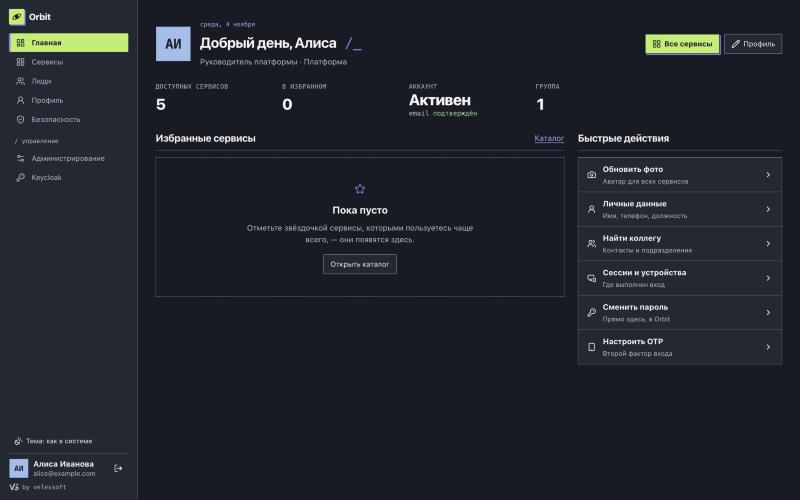
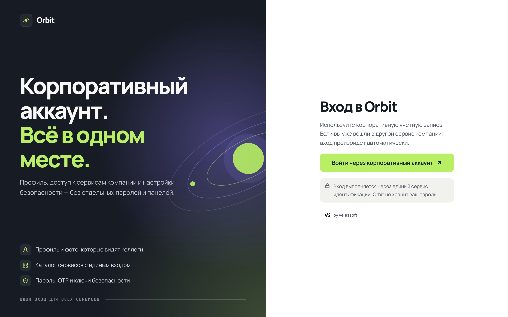
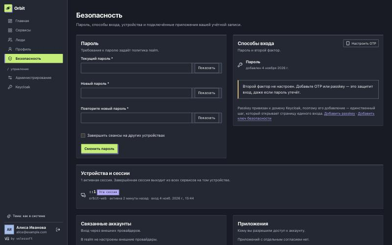
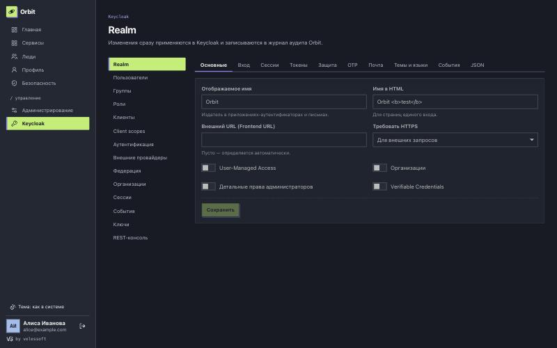
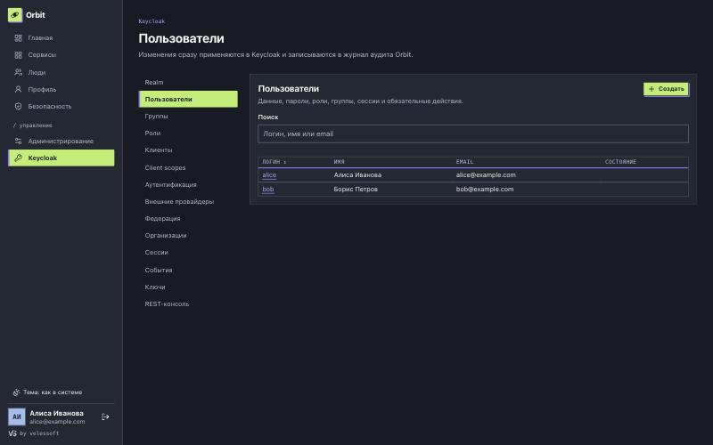
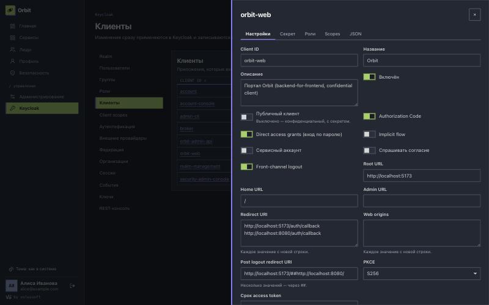
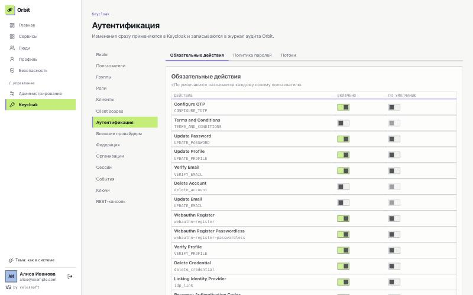
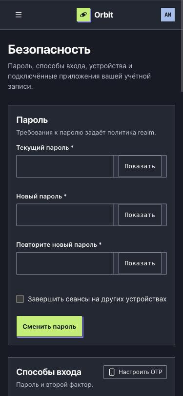

# Orbit

**Orbit — твой корпоративный аккаунт, сервисы и подключения в одном месте.**

Персональный портал сотрудника поверх Keycloak: профиль, аватар, каталог корпоративных сервисов с переходом по SSO, каталог коллег, вход прямо на сайте, все настройки своего аккаунта и всего realm Keycloak из одного интерфейса, регистрация по заявке с одобрением администратором и административная панель. Keycloak остаётся единственным Identity Provider: Orbit не хранит пароли и не реализует собственную аутентификацию.

Стек: **Go** (API, BFF) + **Next.js / TypeScript** (статический экспорт) + **PostgreSQL** + **Keycloak 26**; аватары — локальная ФС или S3-совместимое хранилище.



## Скриншоты

| | |
|---|---|
|  **Вход** — логин и пароль прямо на странице Orbit, без перехода в Keycloak |  **Безопасность** — пароль, OTP, устройства, связанные аккаунты, приложения, история входов |
|  **Keycloak → Realm** — все настройки realm, для остального есть JSON |  **Keycloak → Пользователи** — пароли, роли, группы, сессии, обязательные действия |
|  **Keycloak → Клиенты** — настройки, секрет, роли, scopes |  **Keycloak → Аутентификация** — обязательные действия, политика паролей, потоки |



Тема — системная, светлая или тёмная; интерфейс адаптирован под мобильные экраны.

### Оформление

Интерфейс собран из компонентов **[Velessoft UI](https://github.com/villetacore/velessoft-ui) 0.4** (Open Workshop): `@villetacore/velessoft-ui` и `@villetacore/velessoft-tokens`. Своих кнопок, полей, таблиц и диалогов в Orbit нет; `frontend/src/styles.css` только раскладывает компоненты по экрану и отображает брендинг на токены `--vs-*`.

Пакеты 0.4 ещё не опубликованы в npm, поэтому лежат собранными архивами в `frontend/vendor/` и подключены через `file:`. После публикации замените их обычными версиями в `package.json`.

Администратор меняет оформление в **Администрирование → Оформление** без пересборки: название портала (меню, заголовок вкладки, страница входа), основной и акцентный цвета (цвет текста на кнопках подбирается по контрасту автоматически, при контрасте ниже 4.5:1 показывается предупреждение), фавикон, логотип, заголовок и подзаголовок страницы входа, ссылка или email поддержки. Изменения видны сразу в живом предпросмотре и применяются для всех пользователей после сохранения. Фавикон и логотип принимаются в PNG/JPEG/WebP и **перекодируются в PNG** (SVG и ICO не принимаются, чтобы с домена Orbit не отдавался активный контент).

## Архитектура

```
Браузер ──(cookie сессии, CSRF-токен)──► Orbit API (Go) ──password grant──► Keycloak
   │                                       │   └─ Admin REST API (service account)
   └─ Next.js (статикой из Go или next dev)  ├─► PostgreSQL: каталог, избранное, аватары, сессии, аудит
                                           └─► Avatar storage: ФС или S3
```

- **Вход без редиректа.** Форма на странице Orbit отправляет логин и пароль на бэкенд (`POST /auth/password`), а тот проверяет их в Keycloak через password grant (Direct Access Grants) и сразу открывает сессию. Keycloak по-прежнему применяет свой поток direct grant: пароль, OTP, защиту от перебора, состояние учётной записи. Выход тоже идёт без редиректа: бэкенд завершает сессию Keycloak запросом к его logout-эндпоинту. См. [ограничения](#ограничения-входа-на-сайте).
- **Backend-for-frontend.** Запасной браузерный вход (`/auth/login`, Authorization Code + PKCE) выполняет бэкенд как confidential client. Токены Keycloak хранятся только на сервере (в таблице `sessions`, зашифрованы AES-256-GCM), браузер получает лишь непрозрачный `HttpOnly` cookie. Проверяются подпись, issuer, audience, срок действия и nonce ID-токена; access-токен обновляется по refresh-токену, а отказ Keycloak (сессия завершена, пользователь отключён) завершает и сессию Orbit.
- **Пользователь** идентифицируется по `sub` из OIDC, а не по email.
- **Профиль** читается и меняется через Admin REST API Keycloak от имени отдельного service account `orbit-admin-api`. Пользователь редактирует имя, фамилию и атрибуты из `ORBIT_EDITABLE_ATTRIBUTES`; смена email требует текущий пароль и сбрасывает подтверждение адреса.
- **Аватар.** Источник истины — Orbit (метаданные в PostgreSQL, файл в storage), а не атрибуты Keycloak. Файл проверяется по содержимому (PNG/JPEG/WebP, 64–4096 px, лимит размера), обрезается до квадрата и **перекодируется** в изображение не больше 512×512 — это убирает EXIF и всё, что приклеено к файлу. URL публикуется в стандартный атрибут `picture`, поэтому другие SSO-приложения получают его в claim `picture`.
- **Каталог.** Доступность сервиса решает сервер: статус (`active` / `maintenance` / `hidden`) и список ролей realm (пусто — всем). Переход идёт через `/go/{slug}`: сервер ещё раз проверяет доступ, пишет событие в аудит и делает редирект; приложение авторизует пользователя тем же Keycloak, поэтому повторного входа нет (SSO).
- **Настройки пользователя** (раздел «Безопасность») — смена пароля, подключение и удаление OTP (QR-код, проверка кода), устройства и сессии, связанные аккаунты, выданные разрешения приложений, история входов. Изменение пароля, email и способов входа требует текущий пароль (и код, если он настроен). На страницу Keycloak ведут только добавление passkey или ключа безопасности (WebAuthn привязан к его домену) и привязка внешнего провайдера.
- **Настройки администратора** (раздел «Keycloak», роль `orbit-admin`) — realm (вход, сессии, токены, защита от перебора, OTP, почта с проверкой отправки, темы и языки, события), пользователи, группы, роли, клиенты и их секреты, client scopes, обязательные действия, политика паролей, потоки аутентификации, внешние провайдеры, федерация LDAP, организации, сессии, события, ключи. Для любого поля без отдельной формы есть JSON-редактор, для любого метода Admin REST API — REST-консоль.
- **Люди** — каталог пользователей realm с поиском по имени, логину и email. Сотрудники видят включённых пользователей: имя, email, атрибуты из `ORBIT_EDITABLE_ATTRIBUTES` и `ORBIT_VISIBLE_ATTRIBUTES` и группы; прочие атрибуты Keycloak наружу не отдаются. Администратор (`orbit-admin`) видит и отключённые учётные записи, роли, способы входа и сессии, может изменить имя, email (сбрасывает подтверждение) и атрибуты, отключить или включить аккаунт (отключение сразу завершает сессии; себя отключить нельзя), завершить все сессии и отправить письмо с действиями (`UPDATE_PASSWORD`, `VERIFY_EMAIL`, `CONFIGURE_TOTP`; нужен SMTP в realm).
- **Регистрация по заявке** (`ORBIT_REGISTRATION_ENABLED=true`) — на странице входа появляется «Подать заявку»: имя, фамилия, email, логин и комментарий. Заявка хранится только в Orbit, в Keycloak ничего не создаётся. Администратор видит заявки в **Администрирование → Заявки** (счётчик новых — в меню) и одобряет или отклоняет их. Одобрение создаёт включённого пользователя в Keycloak и отправляет ему письмо Keycloak «задать пароль и подтвердить email»; если realm не может отправить почту, Orbit задаёт временный пароль (Keycloak потребует сменить его при первом входе) и показывает его администратору один раз. Пароли Orbit не хранит. Форма публичная, поэтому ответ одинаковый для новых и повторных заявок (не раскрывает, кто уже подал), действуют лимит 10 запросов в минуту с IP, ловушка для ботов, потолок 500 ожидающих заявок, проверка `Origin` и JSON-тело. Занятость логина и email в Keycloak проверяется при одобрении.
- **Аудит:** вход/выход, изменения профиля (только имена полей), аватар, переходы в сервисы, завершение сессий, заявки на регистрацию и решения по ним, действия администратора над пользователями.

### Принятые решения по открытым вопросам (§12 плана)

| Вопрос | Решение в MVP |
|---|---|
| Frontend / backend / СУБД | Next.js + TS (static export), Go (chi, go-oidc, pgx), PostgreSQL 17 |
| Хранение аватаров | ФС для разработки, S3-совместимое (MinIO, Ceph, AWS) для продакшена |
| Realm | Один realm (`ORBIT_KEYCLOAK_REALM`) |
| Кто управляет каталогом | Пользователи с ролью `orbit-admin` (`ORBIT_ADMIN_ROLE`) |
| Редактируемые поля | Имя, фамилия и `ORBIT_EDITABLE_ATTRIBUTES` (по умолчанию `phoneNumber,jobTitle`); `ORBIT_VISIBLE_ATTRIBUTES` только для чтения |
| Регистрация | Выключена; приглашения — следующий этап |
| Пользовательские интеграции | Связанные IdP и выданные разрешения управляются на странице «Безопасность» |

## Быстрый старт

Нужны Docker, Go 1.27+, Node.js 22+.

```bash
make infra   # PostgreSQL :5432 и Keycloak :8081 с импортом realm "orbit"
```

```bash
make api     # Go API на :8080 (создаст backend/.env из .env.example)
```

```bash
make web     # Next.js на :5173, проксирует /api, /auth и /go на :8080
```

Откройте http://localhost:5173 и войдите:

| Логин / пароль | Роли |
|---|---|
| `alice` / `alice` | `orbit-admin`, `employee`, `developer` — видит админку и все сервисы |
| `bob` / `bob` | `employee` — видит только общедоступные сервисы |

Консоль Keycloak: http://localhost:8081 (`admin` / `admin`).

Всё в контейнерах, одним образом (экспорт Next.js отдаёт Go): `docker compose --profile app up -d --build`, затем http://localhost:8080.

## Kubernetes и Helm

Helm-чарт лежит в [deploy/helm/orbit](deploy/helm/orbit). Keycloak и PostgreSQL чарт не разворачивает — Orbit подключается к уже существующим.

Образ публикуется workflow [release.yml](.github/workflows/release.yml) в `ghcr.io/villetacore/orbit` (multi-arch, `linux/amd64` и `linux/arm64`), а чарт — OCI-артефактом в `oci://ghcr.io/villetacore/charts/orbit`. Как назначаются версии, см. в разделе [Версии и релизы](#версии-и-релизы).

1. Секреты — лучше отдельным Secret (External Secrets, Sealed Secrets, Vault) с ключами `databaseUrl`, `sessionSecret` (≥ 32 символов), `oidcClientSecret`, `keycloakAdminClientSecret`, а для S3 ещё `s3AccessKey`, `s3SecretKey`:

```bash
kubectl -n orbit create secret generic orbit-secrets --from-literal=databaseUrl='postgres://orbit:…@postgres:5432/orbit' --from-literal=sessionSecret="$(openssl rand -base64 48)" --from-literal=oidcClientSecret='…' --from-literal=keycloakAdminClientSecret='…' --from-literal=s3AccessKey='…' --from-literal=s3SecretKey='…'
```

2. Свои значения, например `values.prod.yaml`:

```yaml
config:
  publicUrl: https://orbit.example.com
  keycloak:
    url: https://sso.example.com
    realm: orbit
storage:
  driver: s3
  s3:
    endpoint: s3.example.com
    bucket: orbit-avatars
ingress:
  enabled: true
  className: nginx
  annotations:
    cert-manager.io/cluster-issuer: letsencrypt
  hosts:
    - host: orbit.example.com
      paths: [{ path: /, pathType: Prefix }]
  tls:
    - secretName: orbit-tls
      hosts: [orbit.example.com]
secrets:
  existingSecret: orbit-secrets
```

3. Установка и проверка:

```bash
helm upgrade --install orbit deploy/helm/orbit -n orbit --create-namespace -f values.prod.yaml
```

```bash
helm test orbit -n orbit
```

Что заложено в чарт:

- 2 реплики, `RollingUpdate` без простоя, PodDisruptionBudget, разнесение подов по нодам, опциональный HPA.
- Пробы: `startupProbe` и `livenessProbe` на `/healthz`, `readinessProbe` на `/readyz` (проверяет PostgreSQL — под без базы выводится из балансировки).
- Безопасность пода: non-root (UID 65532, distroless), read-only root filesystem, `drop: [ALL]`, `seccompProfile: RuntimeDefault`, без токена service account.
- Под перезапускается при изменении ConfigMap или Secret (checksum-аннотации).
- Миграции БД применяются при старте под advisory lock — безопасно при нескольких репликах.
- Чарт отказывается рендериться при заведомо нерабочих настройках: нет секретов, короткий `sessionSecret`, `publicUrl` с путём, `storage.driver=fs` с несколькими репликами без `ReadWriteMany`.

Ограничения: rate limiting считается в памяти каждого пода (лимиты фактически умножаются на число реплик); `config.trustProxy: true` держите только за ingress, который перезаписывает `X-Forwarded-For`. Если Keycloak в том же кластере, укажите `config.keycloak.internalUrl` (например, `http://keycloak.keycloak.svc:8080`) — бэкенд будет ходить в него напрямую, а issuer останется публичным.

## Конфигурация

Все параметры — переменные окружения (полный список в [backend/.env.example](backend/.env.example) и [config.go](backend/internal/config/config.go)).

| Переменная | Назначение |
|---|---|
| `ORBIT_PUBLIC_URL` | Origin, по которому браузер открывает Orbit; из него строится redirect URI и проверяется `Origin` |
| `ORBIT_DATABASE_URL` | Строка подключения PostgreSQL; миграции применяются при старте |
| `ORBIT_SESSION_SECRET` | ≥ 32 символов, ключ шифрования сессий и OAuth state |
| `ORBIT_SESSION_TTL` | Максимальная длительность сессии Orbit (по умолчанию `12h`) |
| `ORBIT_KEYCLOAK_URL`, `ORBIT_KEYCLOAK_REALM` | Публичный адрес Keycloak и realm (issuer = `URL/realms/REALM`) |
| `ORBIT_KEYCLOAK_INTERNAL_URL` | Необязательный внутренний адрес Keycloak для бэкенда (например, в docker-сети) |
| `ORBIT_OIDC_CLIENT_ID/SECRET` | Confidential client для входа пользователей |
| `ORBIT_KEYCLOAK_ADMIN_CLIENT_ID/SECRET` | Service account для Admin REST API |
| `ORBIT_ADMIN_ROLE` | Роль realm с доступом к админке |
| `ORBIT_EDITABLE_ATTRIBUTES` / `ORBIT_VISIBLE_ATTRIBUTES` | Атрибуты профиля, редактируемые / только видимые пользователю |
| `ORBIT_STORAGE_DRIVER` | `fs` или `s3` (+ `ORBIT_S3_*`) |
| `ORBIT_AVATAR_MAX_BYTES` | Лимит размера загружаемого файла (по умолчанию 5 МБ) |
| `ORBIT_COOKIE_SECURE` | По умолчанию `true`, если `ORBIT_PUBLIC_URL` на https |
| `ORBIT_TRUST_PROXY` | Брать IP клиента из `X-Forwarded-For` (только за доверенным прокси) |
| `ORBIT_STATIC_DIR` | Каталог статического экспорта Next.js (`frontend/out`); Go отдаёт его страницы, а на неизвестные пути — `404.html` |
| `ORBIT_SEED_DEMO` | Заполнить пустой каталог демо-сервисами |
| `ORBIT_REGISTRATION_ENABLED` | Регистрация по заявке с одобрением администратором (по умолчанию `false`) |

### Настройка Keycloak для своего окружения

Готовый пример — [deploy/keycloak/orbit-realm.json](deploy/keycloak/orbit-realm.json). Если подключаете существующий realm:

1. Клиент `orbit-web`: confidential, Standard Flow и **Direct access grants** (на них работает вход на странице Orbit), PKCE `S256`, redirect URI `https://<orbit>/auth/callback`, post-logout redirect URI `https://<orbit>/`.
2. В клиент `orbit-web` добавить мапперы: *User Realm Role* → claim `roles`, *Group Membership* → claim `groups` (оба в ID token).
3. Клиент `orbit-admin-api`: только service account; роль `realm-management`: `realm-admin` — Orbit управляет всеми настройками realm. Без неё работают только соответствующие части портала, а экраны покажут, каких прав не хватает.
4. В User Profile объявить атрибуты `phoneNumber`, `jobTitle` (редактирует пользователь), `department`, `picture` (редактирует только admin). Атрибуты, не объявленные в профиле, Keycloak молча отбрасывает.

Уже импортированный realm `--import-realm` не обновляет. Для локального стека примените изменения командой `make keycloak-upgrade`, для остальных окружений задайте настройки из пунктов 1 и 3 в консоли Keycloak. Чтобы Keycloak показывал в сессиях и событиях адрес пользователя, а не Orbit, он должен доверять `X-Forwarded-For` от Orbit (`KC_PROXY_HEADERS=xforwarded` за вашим прокси).

### Ограничения входа на сайте

Логин и пароль проходят через бэкенд Orbit, а не только через Keycloak. Это прямое следствие входа без редиректа, и у него есть цена:

- **SSO в другие сервисы.** Браузер не получает cookie сессии Keycloak, поэтому при первом переходе в другой сервис каталога Keycloak один раз спросит пароль. Вход через ссылку «Другой способ» создаёт эту cookie, и переходы остаются бесшовными.
- **Passkey и внешние провайдеры** работают только на странице Keycloak: это ссылка «Другой способ» под формой.
- **Обязательные действия.** Временный пароль Orbit заменяет сам; остальные действия (например, подтверждение email или условия использования) завершаются на странице единого входа, и форма предлагает перейти туда.
- **Условия потока.** Если в потоке direct grant realm есть шаги, которым нужен браузер, вход на сайте их не выполнит.

### Права администратора

Роль `orbit-admin` теперь равна полному администратору realm: через неё можно назначить себе любую роль, прочитать секреты клиентов и изменить политику входа. Выдавайте её так же осторожно, как доступ к консоли Keycloak. Действия выполняются от сервисного аккаунта, поэтому автора изменения показывает журнал аудита Orbit, а не журнал Keycloak. Orbit отказывается удалить realm, сломать свои клиенты и сервисный аккаунт, удалить роль `ORBIT_ADMIN_ROLE`, а также удалить, отключить или лишить этой роли самого себя; это защита от случайностей, а не граница доступа.

## API

| Метод и путь | Описание |
|---|---|
| `POST /auth/password` | Вход с формы Orbit: `{username, password, otp?, newPassword?}` |
| `GET /auth/login?return_to=` | Запасной вход на странице Keycloak (PKCE, state, nonce в зашифрованном cookie) |
| `GET /auth/callback` | Возврат из Keycloak, создание сессии |
| `GET /auth/action/{webauthn-register\|webauthn-register-passwordless\|idp_link:<alias>}` | Действие на странице Keycloak с возвратом на `/security` |
| `POST /auth/logout` | Завершить сессию Orbit и Keycloak без редиректа |
| `GET /go/{slug}` | Переход в сервис с проверкой доступа и аудитом |
| `GET /api/config` | Публичные настройки (включена ли регистрация) |
| `POST /api/register` | Заявка на аккаунт (публично, если включена регистрация) |
| `GET /api/admin/registrations?status=` | Заявки: `pending`, `approved`, `rejected` (`orbit-admin`) |
| `POST /api/admin/registrations/{id}/approve`, `.../reject` | Одобрить (`{"delivery": "auto"\|"password"}`) или отклонить заявку (`orbit-admin`) |
| `GET /api/account/sessions`, `DELETE /api/account/sessions/{id}`, `POST /api/account/sessions/end-others` | Свои сессии Keycloak |
| `GET /api/account/credentials`, `PUT .../{id}/label`, `POST .../{id}/delete` | Свои способы входа (без секретных данных): список, название, удаление |
| `POST /api/account/password`, `POST /api/account/email`, `POST /api/account/verify-email` | Смена пароля и email с проверкой текущего пароля, письмо для подтверждения |
| `POST /api/account/totp/setup`, `POST /api/account/totp` | Подключение OTP: QR-код и подтверждение кодом |
| `GET /api/account/linked`, `DELETE .../{provider}` | Связанные аккаунты |
| `GET /api/account/consents`, `DELETE .../{client}` | Разрешения приложений |
| `GET /api/account/events` | Своя история входов |
| `GET`, `POST`, `PUT`, `DELETE /api/admin/keycloak/*` | Admin REST API realm через Orbit (`orbit-admin`), запись аудируется |
| `GET /api/admin/keycloak-serverinfo` | Каталог провайдеров Keycloak: политики паролей, темы (`orbit-admin`) |
| `GET /api/users?q=&page=`, `GET /api/users/{sub}` | Каталог пользователей и карточка |
| `PATCH /api/admin/users/{sub}`; `POST /api/admin/users/{sub}/logout`, `.../actions-email` | Управление пользователем (`orbit-admin`) |
| `GET /api/branding`, `GET /api/branding/{favicon\|logo}` | Оформление портала и его файлы (публично) |
| `GET`, `PUT /api/admin/branding`; `PUT`, `DELETE /api/admin/branding/{favicon\|logo}` | Изменение оформления (`orbit-admin`) |
| `GET /api/me` | Текущий пользователь и CSRF-токен |
| `GET`, `PATCH /api/profile` | Профиль из Keycloak / изменение разрешённых полей |
| `PUT`, `DELETE /api/profile/avatar` | Загрузка (`multipart/form-data`, поле `file`) / удаление аватара |
| `GET /api/users/{sub}/avatar` | Аватар пользователя (публично, для claim `picture`) |
| `GET /api/services` | Доступные пользователю сервисы и категории |
| `PUT /api/services/{id}/favorite` | `{"favorite": true}` |
| `GET`, `POST /api/admin/services`, `PUT`, `DELETE /api/admin/services/{id}` | Управление каталогом (`orbit-admin`) |
| `GET /api/admin/audit?limit=&before=` | Журнал аудита (`orbit-admin`) |
| `GET /healthz`, `GET /readyz` | Liveness и readiness (с проверкой PostgreSQL) |

Запросы, меняющие состояние, требуют заголовок `X-CSRF-Token` (из `/api/me`) и, если браузер передал `Origin`, совпадение с `ORBIT_PUBLIC_URL`. CORS не включается: фронтенд и API работают на одном origin.

## Безопасность

- Cookie сессии `HttpOnly`, `SameSite=Lax`, `Secure` на https; ID сессии хранится в БД только как SHA-256, содержимое — зашифровано и привязано к ID.
- Сессия пересоздаётся при каждом входе (защита от fixation); `return_to` принимает только относительные пути (нет open redirect).
- URL сервисов и иконок — только абсолютные `http(s)` без учётных данных (нет `javascript:`-ссылок); доступ к сервисам и избранному проверяется на сервере, недоступные сервисы для пользователя неотличимы от несуществующих.
- Rate limiting по IP: `/auth/*`, проверка пароля (отдельный более строгий лимит), загрузка аватаров, все изменяющие запросы. Ответ формы входа не раскрывает, существует ли логин, отключён ли он и включена ли у него 2FA. Пароли не логируются и не хранятся в Orbit; форма принимает только JSON с корректным `Origin`.
- Заголовки: CSP (inline-скрипты Next.js разрешены только по sha256-хешам конкретной страницы, без `unsafe-inline`), `X-Frame-Options: DENY`, `nosniff`, `Referrer-Policy`, HSTS на https.
- Токены Keycloak, включая административные, никогда не попадают в браузер. Прокси Admin API не выходит за пределы realm: запрещены кодированные разделители и `..`, а первый сегмент пути проверяется по списку ресурсов. Тела запросов в журнал не пишутся.

Что остаётся на эксплуатацию: TLS на входе, секреты через secret manager, резервное копирование PostgreSQL и хранилища аватаров, метрики.

## Разработка

```bash
make test    # go test -race + vitest
make lint    # go vet + tsc
make build   # фронтенд и бинарник бэкенда
```

```
backend/
  cmd/orbit/            точка входа, wiring, graceful shutdown
  internal/api/         HTTP: маршруты, middleware (сессия, CSRF, rate limit), обработчики
  internal/auth/        OIDC-провайдер и серверные сессии
  internal/keycloak/    клиент Admin REST API
  internal/totp/        генерация и проверка OTP, совместимых с Keycloak
  internal/avatar/      проверка и перекодирование изображений, ФС/S3
  internal/catalog/     правила видимости и валидация сервисов
  internal/store/       PostgreSQL, миграции, in-memory реализация для тестов
  internal/seal/        AES-GCM и случайные токены
frontend/src/
  app/                  страницы Next.js (App Router): Главная, Сервисы, Профиль, Безопасность, Администрирование
  app/(portal)/keycloak/  маршруты разделов Keycloak
  components/keycloak/  настройки realm: пользователи, клиенты, потоки, REST-консоль
  components/           Layout, Avatar, AvatarEditor (кадрирование), ServiceCard
  branding.tsx          загрузка оформления: заголовок, фавикон, CSS-переменные цветов
frontend/vendor/        собранные пакеты Velessoft UI 0.4
deploy/keycloak/        realm для локальной разработки
deploy/helm/orbit/      Helm-чарт для Kubernetes
```

## Версии и релизы

Версии следуют [SemVer](https://semver.org/lang/ru/), а единственный источник номера — git-теги `vX.Y.Z`. Вручную ничего менять не нужно: `version` в `Chart.yaml` подставляется при упаковке чарта.

Каждый пуш в `main`, в том числе с правками только в документации, — это релиз: зеркало в GitLab ждёт образ `sha-…` для каждого коммита. После прохождения CI [release.yml](.github/workflows/release.yml) публикует образ и чарт, а затем создаёт тег и GitHub Release со списком коммитов. Если шаг упал, тега не будет; перезапуск того же коммита после создания тега версию не меняет.

| Коммиты с прошлого тега | Версия |
|---|---|
| Любые другие | patch: `1.2.3` → `1.2.4` |
| Есть `feat: …` или `feat(ui): …` | minor: `1.2.3` → `1.3.0` |
| Есть `fix!: …` или строка `BREAKING CHANGE:` | major: `1.2.3` → `2.0.0`; пока версия `0.x` — minor |

Первый релиз — `0.1.0`. Выпустить `1.0.0` или задать другое повышение можно вручную: **Actions → Release → Run workflow**, ветка `main`, поле `bump`. Точную версию задаёт тег, запушенный вручную (`git tag v1.4.0 && git push origin v1.4.0`).

Теги образа: `X.Y.Z`, `X.Y`, `latest`, `main`, `sha-…`. В проде указывайте `X.Y.Z`. Версию приложения видно в первой строке его лога (`"msg":"starting","version":"…"`), а вошедшим пользователям — внизу боковой панели.

## Дальше по плану

Регистрация по приглашениям и доменам (этап 5), пользовательские OAuth-интеграции (этап 4), метрики Prometheus, общий rate limiting через Redis для нескольких реплик, статус доступности сервисов, уведомления о важных изменениях аккаунта.
